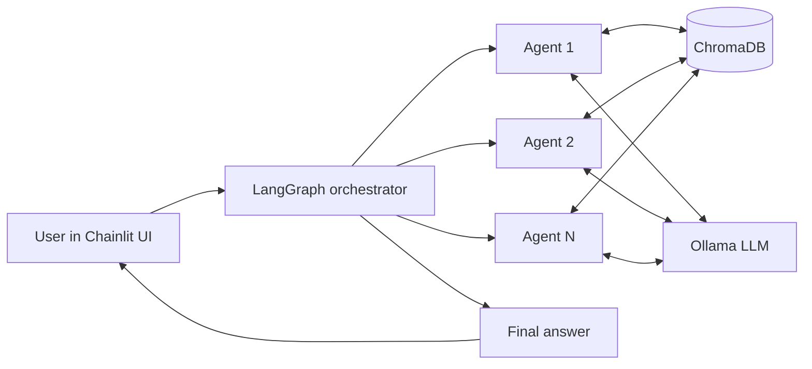

# Multi-Agent Research Scientist

**A research assistant built from cooperating LLM agents that runs entirely on your own machine.**

Instead of one prompt doing everything, the work is split across specialised agents coordinated as a graph. Models run locally through Ollama, so no paid API or cloud service is needed.

## Highlights

- Multi-agent orchestration with **LangGraph**
- Fully local inference with **Ollama**
- Document memory and retrieval with **ChromaDB**
- Interactive chat interface with **Chainlit**
- Zero-cost, privacy-friendly setup

## Architecture



> Replace `Agent 1..N` with your real agent names (for example planner, retriever, critic) and describe each in the table below.

| Agent | Responsibility |
|---|---|
| _name_ | _what it does_ |

## Tech stack

| Layer | Tool |
|---|---|
| Orchestration | LangGraph |
| LLM runtime | Ollama (local models) |
| Vector store | ChromaDB |
| UI | Chainlit |

## Getting started

```bash
git clone https://github.com/<your-username>/<repo>.git
cd <repo>
python -m venv .venv && source .venv/bin/activate   # Windows: .venv\Scripts\activate
pip install -r requirements.txt
ollama pull <model-name>
chainlit run app.py -w
```

Adjust the model name and entry file to match your repo.

## Example

Add a screenshot or short GIF of a run here: `docs/demo.gif`.

## Roadmap

- [ ] Agent-level evaluation
- [ ] More tools for the agents

## Author

Amodh
